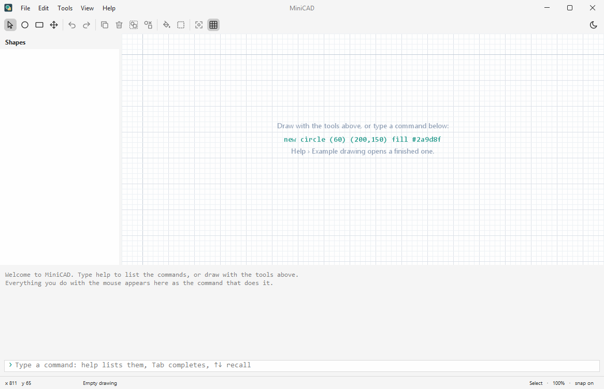
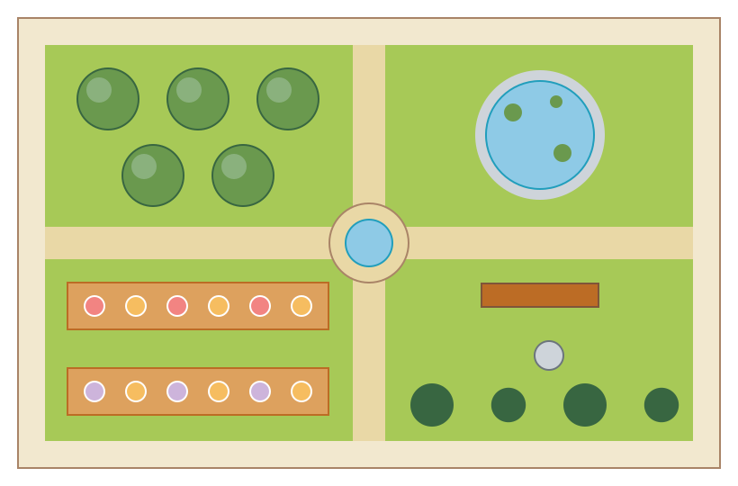
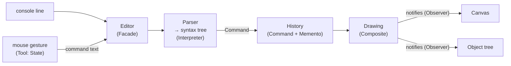
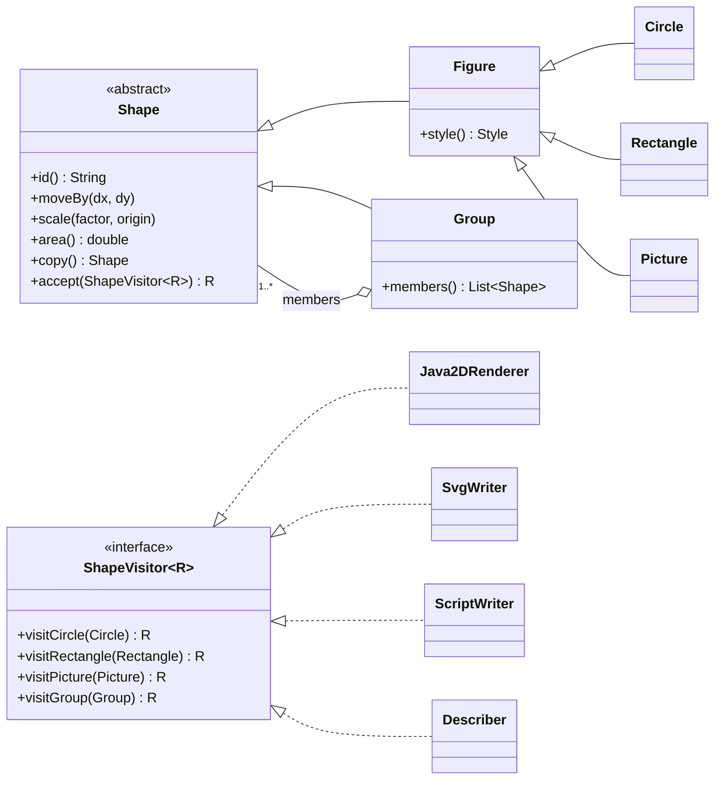
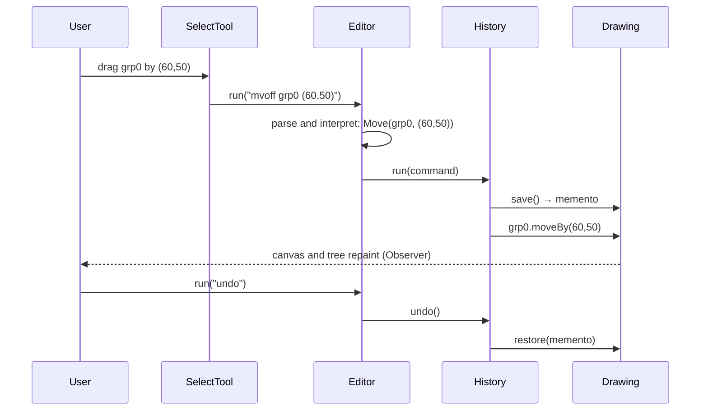

# MiniCAD

**A small 2D CAD driven by a command language, built around the GoF design patterns.**

[](https://github.com/davidecinelli26/minicad/actions/workflows/ci.yml)

[](LICENSE)



MiniCAD draws circles, rectangles and images, groups them, then moves, scales, copies, colours and measures them. Everything is a command of a small language. You can type the commands in the console, or let the mouse write them: dragging a shape writes `mvoff grp0 (60,50)` in the console, and that line goes into the same undo history as the typed ones. A drawing is saved as a script of the same language, and MiniCAD can also run without a window and export the drawing to SVG.

The point of the project is design: every pattern in it solves a problem the program actually has.

## Author

[Davide Cinelli](https://github.com/davidecinelli26). This started as my project for the *Ingegneria del Software* course, University of Calabria, A.Y. 2023/2024. This repository is a rewrite of it. It keeps the same command language and the same core patterns, fixes the bugs, and adds what the original report listed as future work. [What changed](#what-changed-since-the-2024-version) is at the end.

## Try it

You need Java 25 or newer. Download `minicad.jar` from the [releases](https://github.com/davidecinelli26/minicad/releases), or build it:

```bash
./mvnw package
java -jar target/minicad.jar
```

Then type `help`, or open *Help › Example drawing*. To run without a window:

```bash
java -jar target/minicad.jar examples/garden.mcad --svg garden.svg
```

This picture comes from that command. It is the second scenario of the original report, plants laid out in a garden, written as [a script of 58 lines](examples/garden.mcad). The CI renders it again on every push and fails if the result differs from this file.



## The language

```text
› new circle (60) (200,160) fill #2a9d8f
obj0
› new rectangle (360,160) (150,100) fill #e9c46a
obj1
› grp obj0 obj1
grp0
› copy grp0 (0,190)
grp1
› scale grp1 0.5
› area all
grp0  26309.73
grp1  6577.43
total  32887.17
› mv obj9 (10,10)
     ^^^^ there is no shape obj9
› scal grp0 2
  ^^^^ unknown command 'scal': did you mean scale?
› undo
undone: scale grp1 0.5
```

| Command | What it does |
|---|---|
| `new circle (r) (x,y)` | creates a circle; every `new` can end with `fill #rrggbb` and `stroke #rrggbb` (or `none`) |
| `new rectangle (x,y) (w,h)` | creates a rectangle centred on `(x,y)` |
| `new image "file.png" (x,y)` | places an image (PNG, JPEG, GIF or BMP) |
| `copy ID [(dx,dy)]` | duplicates a shape, or a whole group |
| `del ID...` | deletes shapes; a group goes with its members |
| `mv ID (x,y)` · `mvoff ID... (dx,dy)` | moves the centre to a point, or moves shapes by an offset |
| `scale ID factor` | resizes a shape about its centre, or a group about the group's centre |
| `grp ID ID...` · `ungrp ID` | groups shapes, groups included, or dissolves a group |
| `color ID... #rrggbb` | changes the fill, or `fill`/`stroke` separately |
| `ls` · `area` · `perimeter` | followed by ids, a kind (`circle`, `rectangle`, `image`, `groups`) or `all` |
| `save` · `load` · `export` | a `.mcad` script, or an `.svg` image |
| `undo` · `redo` · `clear` · `help [command]` | |

Ids are `obj0`, `obj1`, … for shapes and `grp0`, `grp1`, … for groups. A position is the centre of the shape, and y grows downwards, as on screen. Spaces are free: `( 200 , 160 )` is the same as `(200,160)`. Everything after `//` is a comment. The console completes commands, ids and keywords with Tab, and recalls past lines with ↑ and ↓.

## Design patterns

How a command flows, typed or made by the mouse:



| Pattern | Where | The problem it solves |
|---|---|---|
| **Interpreter** | [`lang`](src/main/java/minicad/lang): `Lexer` → recursive-descent `Parser` → syntax tree, each node `interpret(workspace)` | A real grammar. Errors point at the column, and a mistyped command suggests the right one. An id is checked against the drawing before anything runs. |
| **Command** | [`command`](src/main/java/minicad/command): one object per request; `History` is the invoker | Undo, redo, and one history for the console and the mouse. Queries (`ls`, `area`) are never recorded, so they do not take an undo step. |
| **Memento** | `Drawing.save()` / `restore()`, kept by `History` | Undo puts back a snapshot, so no command needs an inverse operation. Every edit is also atomic: if line 7 of a file fails, the whole `load` is rolled back. |
| **Composite** | `Shape` ← `Figure` (leaves) and `Group` | Groups of groups, at any depth. Moving a group translates it, and scaling it keeps its layout. |
| **Prototype** | `Shape.copy()` | The `copy` command duplicates a whole group without knowing what is inside it, and the snapshots are deep copies. It is a copy method rather than `Cloneable`, which is easier to get right. |
| **Observer** | `Drawing` → `DrawingListener` (canvas, tree); `Selection` → canvas and tree | The views update themselves, and the model knows nothing of Swing. |
| **Visitor** | `ShapeVisitor`: Java2D renderer, SVG writer, script writer, `ls` | Operations that are not part of what a shape *is* live outside the model. Area and perimeter are, so they stay on the shapes. |
| **State** | `Tool`: select, circle, rectangle, pan | The mouse means something different with each tool, and the canvas needs no `if (mode == …)`. |
| **Flyweight** | `ImageStore` | An image file is decoded once. Its copies and the undo snapshots share the pixels, while each keeps its own position and scale. |
| **Facade** | [`Editor`](src/main/java/minicad/app/Editor.java) | The window, the headless runner and the tests all use one entry point. |
| **MVC** | `model` / `Editor` / `ui` | The same split as in 2024, but no longer inverted: the 2024 model wrote into the window. |

The Composite and the Visitor, side by side:



What happens when a group is dragged and the move is then undone:



Two choices on purpose:

- **No Singleton.** In 2024 the panel and the group manager were singletons. They held the model inside the view, and they made tests depend on the order they ran in. Now [`Main`](src/main/java/minicad/Main.java) creates one `Editor`, and the parts receive what they use.
- **Visitor, not a type switch.** Java 25 could do the same job with a `sealed` hierarchy and pattern-matching `switch`. The Visitor is kept because it names each operation as a class and is the pattern this project is about. The cost is the usual one: a new kind of shape means a new method in every visitor.

## What changed since the 2024 version

**Bugs fixed**

- Moving a group put all its members on the same point. Scaling a group scaled each member about its own centre. Both now keep the group's layout.
- The area and perimeter of an image ignored its scale.
- The parser was a `split(" ")`. A space inside `( , )` or a path with spaces broke it, and its errors went to the terminal, so the window showed nothing.
- Undo after `ls` or `area` did nothing visible, because queries were recorded. Undoing a scale used `1/factor` and drifted.
- The command interpreter ignored the handler it was given. Groups could not contain groups, and `grp` with an unknown id put `null` in the group.

**Design**

- The model is out of the view, and the singletons are gone.
- Undo goes through Memento, the parser is a real Interpreter, and the views are a Visitor.
- The Flyweight moved where it saves something: from stateless view objects to image pixels.

**New**

- Mouse tools: select, drag, draw, pan.
- A tree of the groups.
- Colours.
- `copy`, `save`, `load` and `export` to SVG. Saving and loading were excluded requirements of the report.
- Headless mode.
- Zoom, pan, and a grid with snapping.
- Light and dark themes.
- A console with history, completion and errors pointed at the column.

**Engineering**

- Java 25 and Maven Wrapper.
- 93 JUnit tests that run without a window and share no state between them.
- CI on every push, and a runnable jar for each release.

## Project layout

```text
src/main/java/minicad
├── Main.java        composition root: the window, or headless with arguments
├── model/           shapes, groups, the drawing, snapshots, the image store
├── command/         the commands, the history, what commands can reach
├── lang/            lexer, parser, syntax tree: the Interpreter
├── io/              script writer, SVG writer, ls descriptions: Visitors
├── app/             Editor (the Facade), headless runner
└── ui/              window, canvas, tools, object tree, console
examples/garden.mcad the drawing above
```

## License

[MIT](LICENSE)
